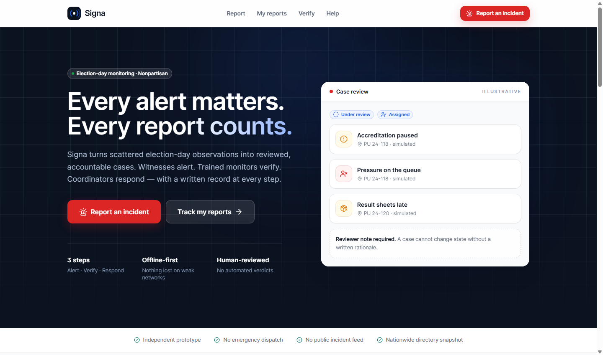
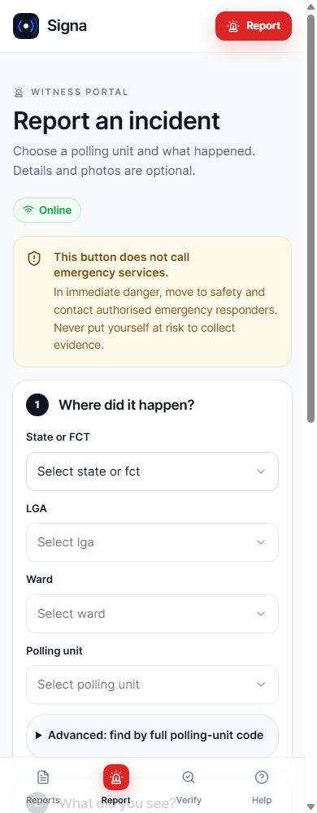
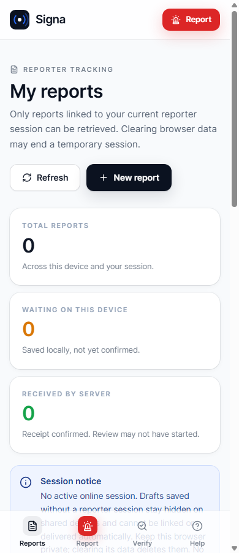
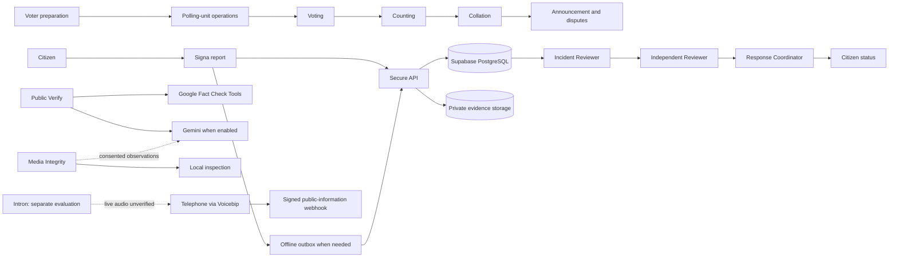
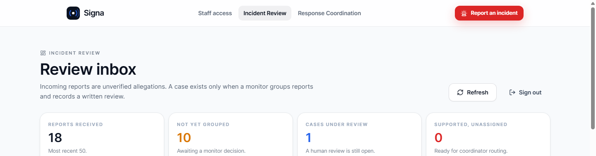
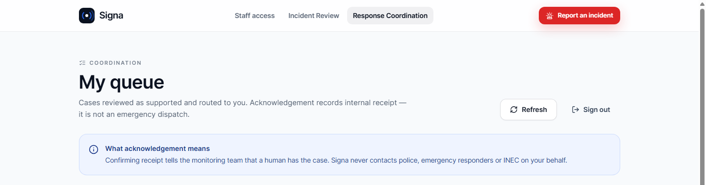
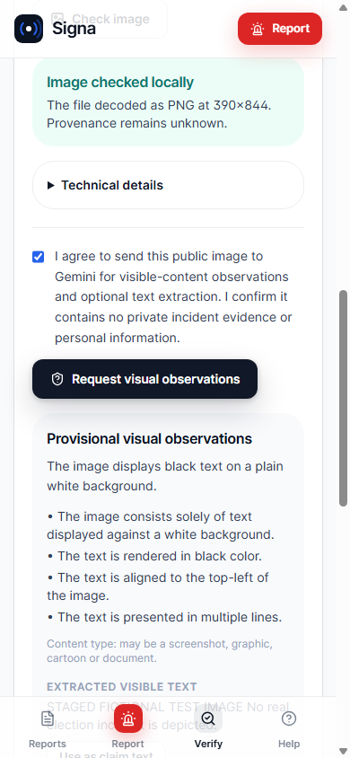

# SIGNA


**Alert. Verify. Respond.**<br>
Every incident heard. Every response accountable.

Signa is a nonpartisan election incident reporting, verification and coordination platform built by **Team 16** for **KTech Fest 3.0 — Every Vote, Every Voice**. It connects citizens, evidence, independent human review and documented follow-up in one secure workflow.

[Live application](https://signa-silk.vercel.app/) · [Source code](https://github.com/ktechfest2/TEAM-16-3.0) · [Problem brief](docs/problem-brief.md) · [Architecture](docs/system-architecture.md) · [Submission write-up](docs/submission-writeup.md)



> **Current acceptance:** On 20 November 2026, a controlled fictional report was submitted on the hosted site, received by the server with a separate photo receipt, independently reviewed, assigned, acknowledged and followed up. The original reporter saw the resulting status. Public Verify citations and a live telephone call remain incomplete. Hosted results and other implemented features are separated below.

## The weak link

Election incidents often move through disconnected calls, messages and social posts. Evidence loses context, rumours spread, reports are duplicated, and the person who reported an incident may never learn what happened next. Nigeria's scale, intermittent connectivity and language barriers widen that gap.

Signa focuses on the path **from witnessing an incident to accountable human follow-up**. It does not conduct elections, certify results or provide emergency dispatch.

## Alert → Verify → Respond

| Step | Signa's role |
| --- | --- |
| **Alert** | A citizen selects a polling unit, describes an allegation, optionally attaches a photo and receives a server-confirmed receipt. An offline outbox can hold the report for retry. |
| **Verify** | Authorized staff inspect private evidence, group potentially related reports and record an independent human decision. AI observations remain provisional. |
| **Respond** | A designated coordinator accepts an internal assignment, records follow-up and exposes a limited status update to the original reporter. |

The accountability loop connects a citizen's receipt to case history and a safe progress update. Independent review separates the person who creates a case from the person who supports its finding.

## What is available

| Experience | Implemented | Hosted acceptance |
| --- | --- | --- |
| Citizen reporting | Anonymous identity, nationwide location selection, optional photo, offline outbox, retry-safe submission and per-report delivery state | **Pass for controlled fictional reporting:** report and photo HTTP 201; retry returned the same receipt; offline save and reconnect produced one server record. Ordinary citizen reporting against real units was not submitted in QA. |
| My Reports | Owner-only tracking with separate delivery, review and response states | **Pass for the controlled reporter:** the report remained visible after refresh with separate supported review and follow-up states. |
| Incident Review | Restricted inbox, grouping, private evidence review, human decision and timeline | **Pass for one fictional case:** Reviewer 1 grouped the report but could not review their own case; Reviewer 2 recorded the independent decision; staged private evidence opened. |
| Response Coordination | Assigned queue, acknowledgement and documented internal follow-up | **Pass for one fictional case:** assignment, idempotent acknowledgement, follow-up and case history persisted after refresh. |
| Public Verify | Text, Link and Image modes, published-source search, Gemini evidence analysis and screenshot text extraction | **Partial:** no-match handling and image extraction worked; the tested article link was not extracted. |
| Media Integrity | Local format, dimensions and hash inspection, comparison with a supplied image, optional Gemini observations | **Partial:** local PNG check and genuine Gemini observations passed with a staged image; broader format/comparison coverage remains. |
| Telephone enquiries | Voicebip line and restricted public-information webhook | **Partial:** the owner confirms the line works; QA verified signed, invalid, replay, no-update and timestamp responses but did not place a call. Live call-to-webhook behavior remains unverified. |




## Designed for Nigerian realities

The mobile reporting interface uses **State/FCT → LGA → Ward → Polling unit** selection without loading the whole directory into a browser. The imported snapshot contains **176,846 polling-unit records**, **8,809 wards**, **774 LGAs**, and **36 states plus the Federal Capital Territory**. These are directory records, not user counts or a certified live INEC integration.

IndexedDB retains reports during connectivity loss. Automatic delivery requires the correct existing reporter session. A locally saved report is not labelled received until its own server receipt is confirmed; photo delivery has a separate status.

## Responsible AI and public verification

Signa Verify searches available published fact checks with Google Fact Check Tools and displays returned citations and dates. Gemini may compare a submitted claim with retrieved evidence, describe visible content in a consented public image, or extract screenshot text for user correction. No returned source means **insufficient evidence**, never proof of truth.

Incident AI assessment is separate and restricted to explicitly authorized fresh fictional submissions. Ordinary citizen reports and older unclassified photographs are not automatically sent to Gemini. AI does not establish an allegation as fact, authenticate a photo, identify a perpetrator, certify an election result or replace independent human review.

Media Integrity can inspect format, dimensions, hash and possible reuse against a user-supplied reference. Missing metadata does not prove manipulation; Gemini is not presented as a synthetic-image detector.

## Telephone accessibility

The Signa telephone line is **0201 350 2097** (international: **+234 201 350 2097**). The owner confirms the telephone service works. Voicebip provides telephone connectivity and a signed tool for general Signa information and approved, dated public updates. The hosted webhook passed signed QA requests; **QA did not observe a real call reaching this webhook**. Telephone incident submission is not implemented.

Intron Sahara speech recognition and synthesis are separate project integrations intended for Nigerian English, Nigerian Pidgin, Yoruba, Hausa and Igbo. This acceptance session did not validate language-specific STT/TTS. **Intron is not verified in the live Voicebip audio pipeline.** Browser microphone interaction is disabled.

## Architecture and roles



Signa supports accountability alongside the wider election process. [See architecture and permission boundaries](docs/system-architecture.md).

| Role | Purpose |
| --- | --- |
| Citizen reporter | Submit and track their own allegations and evidence. |
| Incident Reviewer | Inspect authorized reports, create cases and prepare findings. |
| Independent Reviewer | Record a decision on a case they did not create or contribute to. |
| Response Coordinator | See assigned cases, acknowledge internal responsibility and document follow-up. |

Staff accounts are individually provisioned. Restricted judge accounts have distinct reviewer identities and fictional-only access. Credentials are supplied privately through the submission process. This does not imply full multi-organization isolation.

## Explore

| Page | Link |
| --- | --- |
| Home | [Open](https://signa-silk.vercel.app/) |
| Report | [Open](https://signa-silk.vercel.app/report) |
| My Reports | [Open](https://signa-silk.vercel.app/my-reports) |
| Verify and Media Integrity | [Open](https://signa-silk.vercel.app/verify) |
| Staff access | [Open](https://signa-silk.vercel.app/staff) |
| Incident Review | [Open](https://signa-silk.vercel.app/monitor) |
| Response Coordination | [Open](https://signa-silk.vercel.app/coordinator) |
| Help | [Open](https://signa-silk.vercel.app/help) |
| Telephone information | [Open](https://signa-silk.vercel.app/voice) |





## Technology

| Responsibility | Technologies in this repository |
| --- | --- |
| Interface | Next.js 16.4.6 App Router, React 19.3.0, TypeScript, Tailwind CSS 4, Framer Motion, Lucide, Radix UI |
| Server and data | Next.js route handlers, Supabase Authentication, PostgreSQL, row-level security, private Supabase Storage |
| Offline | IndexedDB and retry-safe synchronization |
| Providers | Google Fact Check Tools, Gemini, Voicebip; Intron Sahara evaluated separately |
| Delivery and tests | Vercel, GitHub Actions, Node.js contract tests, Playwright, TypeScript |

## Local development

Use **Node.js 22 or newer**, npm and your own Supabase development project. Never reuse Signa's production credentials.

```powershell
git clone https://github.com/ktechfest2/TEAM-16-3.0.git
cd TEAM-16-3.0
npm ci
Copy-Item .env.example .env.local
npm run dev
```

Set `NEXT_PUBLIC_SUPABASE_URL` and `NEXT_PUBLIC_SUPABASE_PUBLISHABLE_KEY` for your project. Privileged routes need `SUPABASE_SECRET_KEY` server-side only. Review `supabase/migrations` in chronological filename order and apply only to a verified development project; do not rerun applied SQL blindly.

The directory importer validates its pinned [source and license](docs/attribution.md), hierarchy, checksum and target URL. Run a dry run before an approved import:

```powershell
node scripts/import-polling-directory.cjs C:\path\to\nigeria-inec-geo\data
node --env-file=.env.local scripts/import-polling-directory.cjs C:\path\to\nigeria-inec-geo\data --apply
```

The second command writes to the configured project: use it only after reviewing target identity and dry-run counts. The importer uses bounded idempotent upserts and checks final counts. `.env.example` lists provider, fictional reporting, Gemini, Verify, media and Voicebip variable names. External providers are optional; never put their secrets in `NEXT_PUBLIC_` variables.

```powershell
npm run typecheck
npm test
npm run test:e2e
npm run build
```

## Privacy, testing and limits

The code implements server-side role checks, row-level security, private evidence, independent review, durable rate limits, consent boundaries, case history and separate fictional-test access. Hosted checks confirmed wrong-role staff APIs return 403, unauthenticated monitor access returns 401, private evidence listing without authorization returns 401, and invalid/replayed webhook calls are rejected. One complete fictional report lifecycle passed. This is not a security certification.

The current local run passed **62 unit/contract tests**, typecheck and production build. The repository lists **39 Playwright tests**; a previous CI run passed them, while this Windows session's local Playwright web-server startup stalled and was stopped. Hosted browser acceptance is separate; its current status appears above. No adoption or impact statistics are claimed.

Signa is independent and nonpartisan. It is not affiliated with INEC, Yiaga Africa, the police or emergency services. External referrals require authorized arrangements. Reports remain allegations until a human decision.

## Hackathon submission and credits

The [problem brief](docs/problem-brief.md), [architecture sketch](docs/system-architecture.md), [short submission write-up](docs/submission-writeup.md), application and public source address the KTech Fest 3.0 challenge. A demo-video link will be added only when the completed video is available.

Built by **Team 16** with development assistance from ChatGPT, OpenAI Codex and Claude Code, and using Google Gemini, Google Fact Check Tools, Voicebip, Intron Sahara and open-source libraries. [Full attribution and dataset provenance](docs/attribution.md). This repository does not declare a project license.
