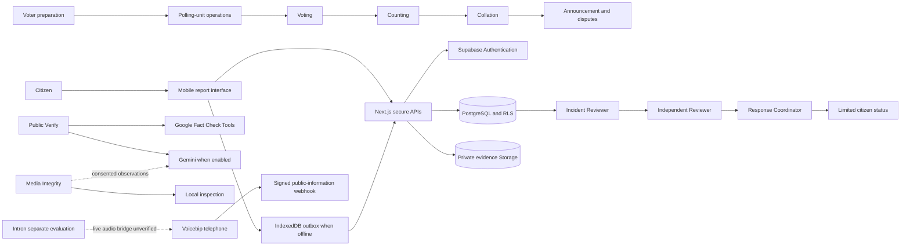

# System architecture

Signa is a supporting incident reporting and accountability layer alongside the election process.

## Trust boundaries

The browser can retain pending reports in IndexedDB. A report is delivered only after a matching server receipt. Citizen identity and staff sign-in use different client storage; staff authorization is checked on the server and in PostgreSQL. Judge staff accounts are restricted to fictional records. Report evidence is stored privately and accessed through authorized, short-lived retrieval routes.

Related reports may be suggested by location and time, but matching accounts or counts are not proof of independent witnesses. Human review and response status are separate. Case events form an append-only history. Coordinator acknowledgement means internal responsibility, not a dispatch.

Fictional reporting authorization is separate from external AI authorization. Only explicitly eligible new fictional records may be sent to an incident assessment provider. Public Verify operates on user-supplied public claims and consented images, independently of private incident evidence. Its results require real retrieved sources and show uncertainty.

Voicebip's signed tool is limited to general Signa information and approved, dated public summaries. It cannot retrieve witness identities, private reports, evidence or staff records. Intron speech has been assessed separately; a live Voicebip–Intron audio connection is not verified.

## Deployment boundary

Next.js runs on Vercel. Supabase provides authentication, PostgreSQL and private object storage. Server-only credentials remain outside the browser bundle. The directory comes from a pinned external dataset snapshot, not a live INEC feed. Production migrations and imports require a verified target and owner review.
